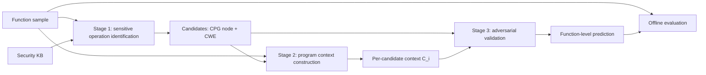

# ARGUS Reproduction: Evidence Context Construction and Adversarial Validation

`Vulhihi` reproduces ARGUS (NSS-SocialSec 2026, paper 93), a three-stage
function-level vulnerability detector for C/C++. Stage 1 identifies
security-sensitive operations with a curated knowledge base. Stage 2 builds a
candidate-specific program context from a Joern CPG. Stage 3 validates each
candidate with a Prosecutor, a Defender, and an Adjudicator, then projects the
candidate verdicts to a function-level prediction.

The repository is mid-rebuild. Stage 1 and Stage 2 were removed and will be
rewritten to follow the paper; Stage 3 runs on a fixed Stage 2 fixture. Paper
notes, the code-versus-paper gap analysis, and the recorded decisions live in
[`papers/notes.md`](papers/notes.md),
[`papers/gap-analysis.md`](papers/gap-analysis.md), and
[`papers/decisions.md`](papers/decisions.md). The removed Stage 1/2 code is
recoverable from commit `9a7ede2`.

## Pipeline



| Stage | Work | Main input | Main output | Status |
|---|---|---|---|---|
| 1 | Exact API match on CPG call names, constrained LLM fallback | `func`, frozen KB | Candidates `(node, CWE)` | Not implemented |
| 2 | Slice from the candidate node, add control dependencies, source facts, bounded call context | `func`, Stage 1 candidates | `contexts[]` with `compact_code` | Not implemented; fixture only |
| 3 | Prosecutor and Defender analyze the same context independently; an Adjudicator decides from `(P_i, D_i, C_i)` in one pass | Stage 2 packet and its candidate sink | Per-candidate verdict and function prediction | Runs; follows the paper (Fig. 1, Eq. 4) |

Stage 3 follows paper Fig. 1: the Prosecutor and Defender never see each other's
output, the Adjudicator receives both analyses plus the context, and there are no
rounds or voting. Whether the candidate CWE is shown to the agents is an open
decision in [`papers/decisions.md`](papers/decisions.md); it is not sent today.

## Data and inference boundary

The Stage 3 fixture pairs a Stage 2 artifact with an oracle file. Each oracle
record is one JSON line:

```json
{
  "sample_id": "sven_test_pair_000001_vul",
  "idx": 0,
  "func": "MagickExport Image *AdaptiveThresholdImage(const Image *image, ...) { ... }",
  "label": "VULNERABLE",
  "cwe": "CWE-125",
  "pair_id": "CWE-125_1"
}
```

Inference applies explicit projections:

- Stage 3 sends the candidate sink (`line_start`, `line_end`, `expression`,
  `operation_type`, `candidate_status`) and the Stage 2 `compact_code`, rendered
  with `L<number>` citations. It does not send `label`, dataset `cwe`,
  `pair_id`, or the complete function.
- A candidate whose Stage 2 context has no `compact_code` is reported as
  `invalid_candidate_or_context`. Raw function source is never sent to the
  model as a fallback.
- The runner reads `func` only to validate that every cited line matches the
  processed source.
- Labels are joined after inference for metrics. Stage 3 result rows carry
  `ground_truth` and `ground_truth_cwe` for reporting only.

All artifacts join by `(sample_id, idx)`. Candidate-level results also retain
`sink_rank`; row order is not a join key.

## Datasets

| Path | Content | Role |
|---|---|---|
| `data/fixtures/stage2.jsonl` | 160 SVEN functions (CWE-125, 80 V / 80 B), 472 candidate contexts | Fixed Stage 3 input |
| `data/fixtures/sven_test_oracle.jsonl` | 590 SVEN functions (CWE-125/190/416/476) with labels | Labels for the fixture |
| `data/raw/llmxcpg/sven_test.json` | LLMxCPG SVEN artifact, 254 rows (129 V / 125 B), matches paper Table 3 | Paper evaluation set; not yet wired into the pipeline |
| `data/raw/llmxcpg/*.audit.json`, `*.provenance.json` | Duplicate audit and download provenance (`qcri/llmxcpg@fd7af0d`) | Records |

The fixture is not the paper's evaluation set: metrics on it check Stage 3
behavior and are not comparable with paper Tables 5–7. PrimeVul is not in the
repository yet. Do not deduplicate the 254-row artifact unless an experiment
defines that policy; the paper keeps it as released.

## Install and configure

Use Python 3.10 or newer and install the dependencies:

```powershell
python -m venv .venv
.\.venv\Scripts\Activate.ps1
python -m pip install -r requirements.txt pytest
```

LLM settings live in [`configs/llm.yaml`](configs/llm.yaml):

| Key | Default | Purpose |
|---|---|---|
| `provider` | `openrouter` | `openrouter`, `deepseek`, or `openai-compatible` |
| `model` | `qwen/qwen3-32b` | Paper uses Qwen3-32B |
| `base_url` | `https://openrouter.ai/api/v1` | Endpoint base; for `openai-compatible`, end it with `/v1` |
| `api_key_env` | `OPENROUTER_API_KEY` | Name of the environment variable holding the key |
| `temperature` | `0` | Paper: 0 whenever supported |
| `max_tokens` | `4096` | Not stated in the paper |
| `thinking` | `false` | `true`, `false`, or `null` (parameter not sent); not stated in the paper |
| `timeout_seconds`, `max_attempts` | `180`, `3` | HTTP timeout and retries with exponential backoff |

API keys stay in the environment or a local `.env`, which must not be
committed. The config file holds no secrets.

## Run Stage 3

```powershell
# Validate joins and count usable candidates without API calls
python scripts/run_stage3.py --dry-run

# Small pilot
python scripts/run_stage3.py --limit 5 --workers 1

# Full fixture with explicit options
python scripts/run_stage3.py `
  --stage2 data/fixtures/stage2.jsonl `
  --data data/fixtures/sven_test_oracle.jsonl `
  --llm-config configs/llm.yaml `
  --workers 4
```

`--model` overrides `model` from the config. `--profile` selects the prompt set:
`faithful` (default, `prompts/faithful/`) keeps only what the paper describes;
`enhanced` (`prompts/`) adds an evidence contract that the paper does not
describe. `--prosecutor-prompt`, `--defender-prompt`, and `--adjudicator-prompt`
override a single role. `--start` and `--limit` select a slice of samples. The
plan for the two profiles is in `docs/stage3_plan.md`.

Each run writes a new timestamped directory unless `--output` is given:

```text
outputs/runs/<timestamp>/
  stage3.jsonl      # one row per sample with candidate_results[]
  summary.json      # n_total/n_valid/n_error, error causes, confusion counts, metrics
  requests.jsonl    # run configuration and HTTP audit log
```

Runs are resumable: pass `--output` with an existing `stage3.jsonl`. A row is
reused only when its run signature matches the protocol, prompt files, and the
full LLM configuration. `--no-resume` processes every selected
sample again.

## Outputs and status interpretation

- **Candidate results** record the sink snapshot, the Prosecutor analysis
  (`prosecutor`), the Defender analysis (`defender`), the `adjudicator` verdict,
  and any validation repairs or errors.
- **Function prediction** is `VULNERABLE` when at least one candidate is
  `VULNERABLE`. It is `BENIGN` only when every candidate has a valid `BENIGN`
  verdict. Otherwise the prediction is `null` and the sample is excluded from
  metrics. A function with no candidates is predicted `BENIGN`.
- **Metrics** in `summary.json` (precision, recall, F1, FPR, accuracy) use only
  samples with a binary prediction, as in paper tr. 10. The summary also records
  `n_total`, `n_valid`, `n_error`, and `error_causes` so the denominator is explicit. Per-CWE metrics are not
  implemented yet. The console also prints vulnerable/fixed pair metrics.

## Tests

```powershell
python -m pytest -q
```

`tests/test_stage3_fixture.py` checks the fixture joins (472 candidates, 461
usable), that no label leaks into prompts, and that missing contexts fail
instead of sending raw code. `tests/test_llm_config.py` checks config loading
and the request body for each provider. Neither calls a model.

## Repository map

```text
Vulhihi/
|-- argus/
|   |-- io.py                    # JSONL helpers, timestamped run directories
|   |-- llm/
|   |   |-- config.py            # LLMConfig and YAML loader
|   |   `-- client.py            # Chat-completions client with retries and logs
|   `-- stage3/
|       |-- protocol.py          # Agents, schemas, validation, Adjudicator
|       `-- runner.py            # CLI, joins, aggregation, metrics
|-- configs/llm.yaml             # LLM settings
|-- prompts/                     # enhanced profile: prosecutor/defender/adjudicator.txt
|   `-- faithful/                # default profile, paper description only
|-- scripts/run_stage3.py        # Stage 3 entry point
|-- data/
|   |-- fixtures/                # Stage 2 fixture and oracle
|   `-- raw/llmxcpg/             # LLMxCPG SVEN artifact and audits
|-- tests/
|-- papers/                      # Paper PDF, notes, gap analysis, decisions
|-- docs/stage3_plan.md          # Stage 3 faithful/enhanced plan (git-ignored)
`-- outputs/                     # Run directories (git-ignored)
```

## Scope and limitations

- Stage 1 and Stage 2 are not implemented, so no result in this repository
  reproduces a paper table yet.
- The fixture covers one CWE and full SVEN functions, not the paper's
  254-row slice artifact or PrimeVul.
- Stage 3 matches the paper's structure but the candidate CWE is not shown to
  the agents, and failures are handled as described above rather than by a
  rule from the paper.
- Stage 3 reasons over selected source evidence; a `BENIGN` verdict means no
  vulnerability was established, not a proof of safety.
